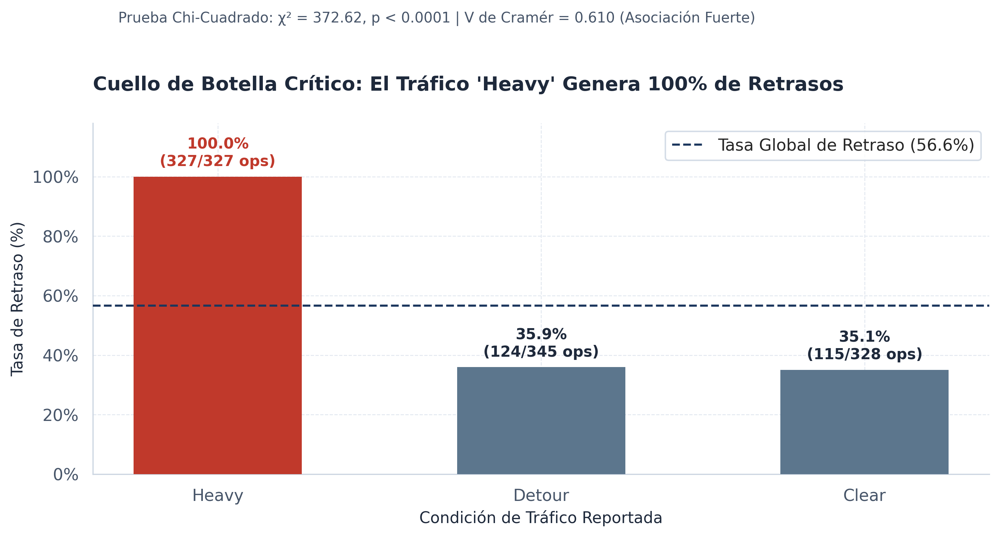
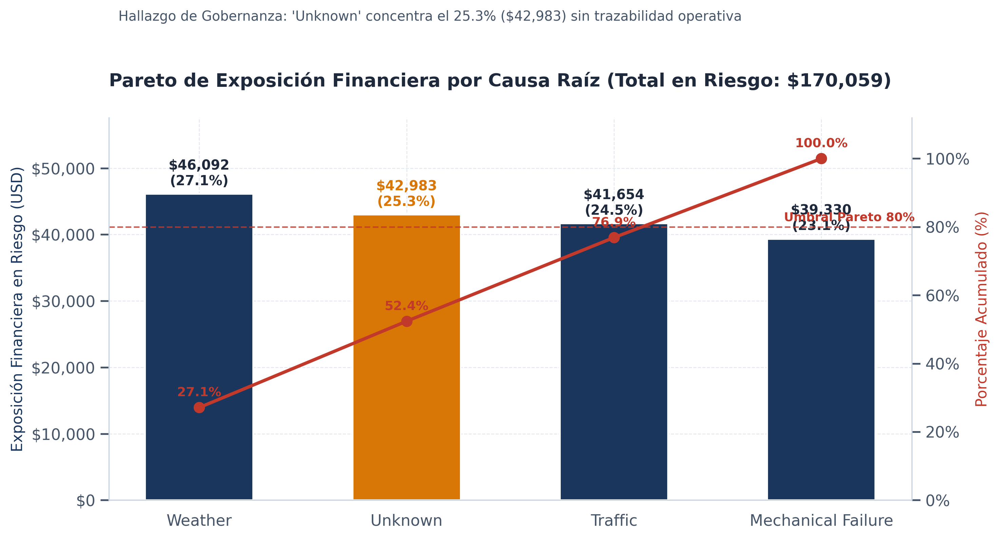
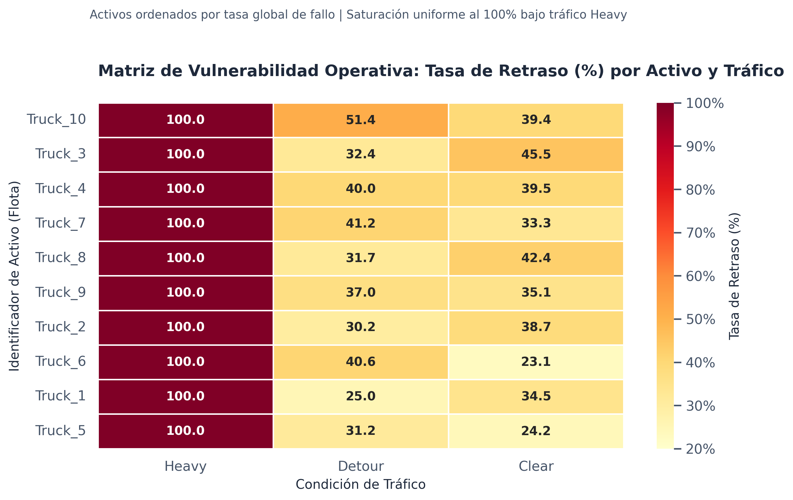
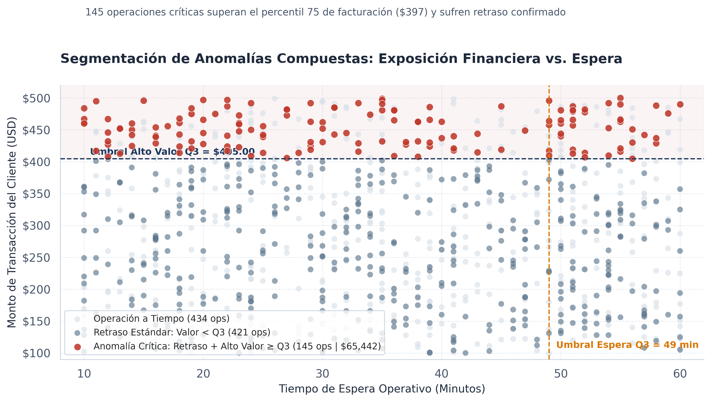

# 🚚 Optimización de Operaciones Logísticas y Control de Riesgo Financiero


## 📋 Resumen Ejecutivo (*Bottom Line Up Front*)

Este proyecto aplica **Estadística No Paramétrica, Detección de Anomalías Compuestas y Análisis de Pareto (80/20)** sobre 1.000 operaciones de una red logística monitoreada por IoT, con el objetivo de identificar cuellos de botella operativos y cuantificar la exposición financiera por retrasos.
Fuente del dataset: https://www.kaggle.com/datasets/ziya07/smart-logistics-supply-chain-dataset

### Indicadores Clave Auditados
* **Facturación Total Analizada:** `$299,055.00` (1.000 operaciones en 10 activos de transporte).
* **Tasa Global de Retrasos:** `56.6%` (566 operaciones retrasadas), comprometiendo **`$170,059.00` (56.87% de los ingresos)**.
* **Cuello de Botella Determinístico:** El estado de tráfico **`Heavy`** presenta una **tasa de retraso del 100.0%** (327/327 operaciones), frente al ~35.5% en condiciones `Clear` y `Detour` ($\chi^2 = 372.62, p < 0.0001, V\text{ de Cramér} = 0.610$).
* **Anomalías Críticas de Alto Valor:** Se aislaron **145 operaciones críticas** (retraso confirmado con facturación $\ge Q_3$ de `$397.00`), concentrando **`$65,442.00` en exposición directa**.
* **Brecha de Gobernanza de Datos:** El **25.97% de los retrasos (147 operaciones / `$42,983.00`)** carecen de causa raíz registrada (`Unknown`), representando un punto ciego crítico de control de gestión.

---

## 🔬 Metodología y Arquitectura del Pipeline

El proyecto sigue una arquitectura modular reproducible desacoplada en cuatro etapas ejecutables mediante un orquestador único (`main.py`):

1. **Auditoría de Calidad e Imputación Semántica (`src/01_data_cleaning.py`):** Validación de esquema, reglas de dominio físico/financiero y diferenciación entre nulos estructurales (`No Delay`) y sub-registros operativos (`Unknown`).
2. **EDA y Contrastes de Hipótesis (`src/02_eda_statistics.py`):** Pruebas de normalidad (**Shapiro-Wilk**), contrastes no paramétricos (**U de Mann-Whitney**, **Kruskal-Wallis H**) con cálculo de **Tamaño del Efecto** (*Rank-Biserial Correlation* y *V de Cramér*) para evitar falsos positivos por tamaño muestral.
3. **Detección de Anomalías y Pareto 80/20 (`src/03_anomalies_pareto.py`):** Evaluación univariada (IQR de Tukey y Z-Score), diseño de indicadores compuestos de exposición financiera e índice ponderado de riesgo operativo.
4. **Visualización Ejecutiva (`src/04_visualizations.py`):** Exportación automatizada de gráficos editoriales a 300 DPI.

---

## 📊 Hallazgos Visuales y Evidencia Estadística

### 1. Impacto Determinístico del Tráfico en los Retrasos
Mientras las variables continuas como `Waiting_Time` muestran un tamaño del efecto despreciable ($r_{rb} = 0.073$), la condición de tráfico actúa como un interruptor binario de falla logística bajo saturación (`Heavy`).



### 2. Pareto de Exposición Financiera y Brecha de Trazabilidad
Las cuatro causas de retraso presentan una distribución homogénea en volumen (~23%–27%), pero el análisis monetario revela que **`$42,983.00` (25.3% del monto retrasado)** no tiene causa documentada (`Unknown`), impidiendo asignar responsabilidades contractuales o correctivas.



### 3. Matriz de Vulnerabilidad por Activo de Flota
Ningún vehículo logra mitigar el tráfico `Heavy` (100% de fallos en toda la flota `Truck_1` a `Truck_10`), aunque `Truck_10` (64.8% de retrasos globales) y `Truck_3` (62.4%) exhiben mayor vulnerabilidad en rutas con desvíos (`Detour`).



### 4. Cuadrantes de Anomalías Compuestas (Alto Valor vs. Espera)
Dado que las variables individuales siguen distribuciones acotadas sin *outliers* univariados (0 desvíos por IQR/Z-Score), el cruce multivariado permite priorizar las **145 operaciones de alto valor ($\ge Q_3$) retrasadas**, focalizando la intervención donde el impacto económico es máximo.



---

## 💡 Recomendaciones de Optimización y Control de Gestión

| Palanca de Intervención | Acción Propuesta | Impacto Cuantificado Estimado |
| :--- | :--- | :--- |
| **1. Ruteo Dinámico Anti-Congestión** | Implementar desvío preventivo automático (`Detour`) cuando las alertas IoT proyecten tráfico `Heavy` en envíos de alto valor ($\ge \$397$). | Reducir la tasa de fallo del **100% al ~35.9%**, protegiendo hasta **`~$41,900`** en facturación crítica. |
| **2. Control Obligatorio de Causa Raíz** | Bloquear el cierre de órdenes retrasadas en el sistema sin tipificación de motivo (eliminando la categoría `Unknown`). | Recuperar trazabilidad sobre **`$42,983` (25.3% del riesgo)** para gestión de SLA y mantenimiento. |
| **3. Auditoría Técnica de Flota** | Priorizar mantenimiento preventivo en `Truck_10` (64.8% retrasos) y `Truck_3` (62.4%), equiparándolos al benchmark de `Truck_5` (49.5%). | Reducción estimada de **12 a 15 puntos porcentuales** en la tasa de incumplimiento de los activos críticos. |

---

## ⚙️ Instalación y Reproducibilidad

```bash
# 1. Clonar el repositorio
git clone [https://github.com/AleRC99/smart-logistics-optimization]
cd smart-logistics-optimization

# 2. Crear y activar entorno virtual
python -m venv venv
source venv/bin/activate        # En Windows: .\venv\Scripts\Activate.ps1

# 3. Instalar dependencias
pip install -r requirements.txt

# 4. Descargar el dataset de Kaggle en data/raw/ y ejecutar el pipeline completo
python main.py